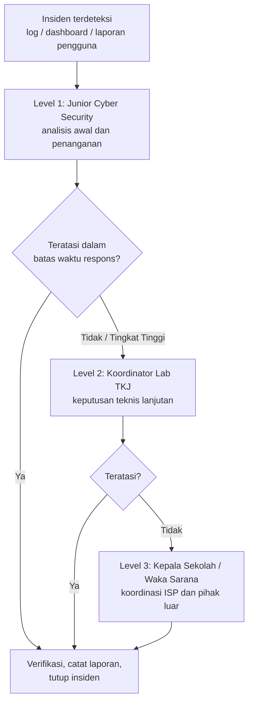

# SOP Penanganan Insiden
## Laboratorium Jaringan SMK XYZ — UKK TKJ 2026, SPK Paket 1

SOP ini mengatur langkah penanganan insiden pada router, server, dan jaringan VLAN. Dokumen ini melengkapi [`KEBIJAKAN-KEAMANAN.md`](./4-KEBIJAKAN-KEAMANAN.md).

---

## 1. Peran dan Tanggung Jawab

| Peran | Tanggung jawab |
|---|---|
| **Junior Cyber Security** (Level 1) | Mendeteksi, menganalisis awal, dan menangani insiden; mencatat laporan |
| **Koordinator Lab TKJ** (Level 2) | Mengambil keputusan teknis lanjutan, menyetujui tindakan besar (reset perangkat, pemutusan jaringan) |
| **Kepala Sekolah / Waka Sarana** (Level 3) | Keputusan kebijakan, komunikasi ke pihak luar (ISP, instansi terkait) |

> Isi nama dan nomor kontak pada tabel di bagian 5 sebelum SOP ini dipakai.

---

## 2. Klasifikasi Insiden

| Tingkat | Contoh | Target respons |
|---|---|---|
| **Rendah** | Percobaan login gagal sesekali, satu klien tidak mendapat IP | 1 jam |
| **Sedang** | IP masuk daftar blokir brute-force, satu layanan server mati | 30 menit |
| **Tinggi** | Login ke router berhasil dari sumber tidak dikenal, server mati total, trafik tidak normal | 15 menit |

---

## 3. SOP Tindakan Saat Terjadi Brute-Force

**Deteksi.** Tanda-tandanya:
- Log router berisi banyak entri `LOGIN-ATTEMPT` dari IP yang sama.
- Daftar `ssh_stage1`, `ssh_stage2`, `ssh_stage3`, atau `blacklist` terisi.

**Langkah penanganan:**

1. **Konfirmasi insiden.** Di Terminal Winbox:
   ```
   /ip firewall address-list print
   /log print where message~"LOGIN-ATTEMPT"
   ```
2. **Identifikasi sumber.** Catat IP penyerang, tentukan VLAN asalnya (192.168.10.x = Guru, 192.168.20.x = Siswa, 192.168.30.x = Server), lalu cari perangkat dan penggunanya.
3. **Tahan serangan.** IP yang mencoba 4 koneksi baru dalam ±1 menit otomatis masuk `blacklist` selama 1 hari. Untuk memblokir permanen:
   ```
   /ip firewall address-list add list=blacklist address=192.168.20.50 comment="Blok manual - brute force"
   ```
   *(ganti alamat dengan IP penyerang)*
4. **Periksa apakah ada login berhasil:**
   ```
   /user active print
   /log print where message~"logged in"
   /user print
   /ip service print
   ```
   Waspadai akun baru yang tidak dikenal atau layanan yang aktif tanpa izin.
5. **Jika ada indikasi login berhasil** (Tingkat Tinggi): ganti password semua akun, ganti community SNMP, bandingkan konfigurasi dengan backup terakhir (`/export`), lalu **eskalasi ke Level 2**.
6. **Tindak lanjut pengguna:** panggil dan edukasi pemilik perangkat, periksa apakah perangkat terinfeksi, dan terapkan sanksi sesuai kebijakan.
7. **Pulihkan akses administrator jika terkunci.** Sambungkan lewat MAC-Winbox dari PC Admin di jalur Host-Only/Ether3 (tab **Neighbors**, klik MAC Address router), lalu hapus entri administrator saja:
   ```
   /ip firewall address-list remove [find list=blacklist address=192.168.10.5]
   ```
8. **Catat laporan** (lihat bagian 6).

**Pencegahan:** password kuat, akun `admin` bawaan dinonaktifkan, dan akses SSH/Winbox tetap dibatasi hanya dari VLAN 10 dan VLAN 30.

---

## 4. SOP Tindakan Saat Server Down

**Deteksi.** Tanda-tandanya: `https://lab-smk.xyz` atau `https://monitor.lab-smk.xyz` tidak terbuka, dashboard monitoring berhenti memperbarui, atau klien tidak dapat me-resolve domain.

**Langkah penanganan:**

1. **Cek VM hidup.** Buka konsol VM server di VMware. Jika mati, nyalakan, lalu catat waktu dan penyebabnya.
2. **Cek jaringan.** Dari router: `/ping 192.168.30.10`. Di server:
   ```bash
   ip a
   ping -c 4 192.168.30.1
   ```
   Jika gagal, periksa kabel virtual, VLAN 30 di switch, dan alamat static di netplan.
3. **Cek layanan:**
   ```bash
   sudo systemctl status named nginx netdata
   ```
4. **Cek resource:**
   ```bash
   df -h        # disk penuh?
   free -m      # memori habis?
   ```
5. **Baca log penyebab:**
   ```bash
   sudo journalctl -xeu bind9 --no-pager | tail -n 30
   sudo tail -n 30 /var/log/nginx/error.log
   ```
6. **Perbaiki.**
   - Validasi konfigurasi: `sudo named-checkconf` dan `sudo nginx -t`.
   - Jalankan ulang layanan: `sudo systemctl restart named nginx netdata`.
   - Jika file konfigurasi rusak, kembalikan dari backup (lihat kebijakan backup).
   - Jika disk penuh, hapus file sementara dan log lama.
7. **Verifikasi pemulihan:**
   ```bash
   dig @192.168.30.10 lab-smk.xyz
   curl -k https://lab-smk.xyz
   curl -k https://monitor.lab-smk.xyz
   ```
   Pastikan juga router dan server kembali tampil di dashboard monitoring.
8. **Eskalasi** ke Level 2 jika layanan belum pulih dalam **30 menit**, atau jika penyebab diduga serangan.
9. **Catat laporan dan evaluasi** penyebab (bagian 6).

---

## 5. Alur Eskalasi



| Level | Pihak | Dihubungi bila | Batas waktu | Kontak |
|---|---|---|---|---|
| 1 | Junior Cyber Security | Semua insiden | Sesuai tingkat (bagian 2) | `[isi nama / nomor]` |
| 2 | Koordinator Lab TKJ | Tidak teratasi dalam batas waktu, atau Tingkat Tinggi | Langsung | `[isi nama / nomor]` |
| 3 | Kepala Sekolah / Waka Sarana | Tidak teratasi di Level 2, atau berdampak luas | Maksimal 2 jam | `[isi nama / nomor]` |
| Eksternal | Penyedia internet (ISP) | Gangguan di sisi koneksi internet | Sesuai SLA ISP | `[isi nomor ISP]` |

---

## 6. Formulir Laporan Insiden

| Kolom | Isi |
|---|---|
| No. laporan / tanggal / jam | |
| Pelapor | |
| Jenis insiden | Brute-force / Server down / Lainnya |
| Tingkat | Rendah / Sedang / Tinggi |
| Perangkat terdampak | |
| IP sumber (jika ada) | |
| Kronologi singkat | |
| Tindakan yang dilakukan | |
| Waktu pemulihan | |
| Penyebab (akar masalah) | |
| Tindak lanjut pencegahan | |
| Dieskalasi ke | Tidak / Level 2 / Level 3 |
| Status | Selesai / Dalam proses |

Simpan laporan minimal 1 tahun. Setelah insiden Sedang atau Tinggi, lakukan evaluasi singkat dan perbarui kebijakan bila perlu.
